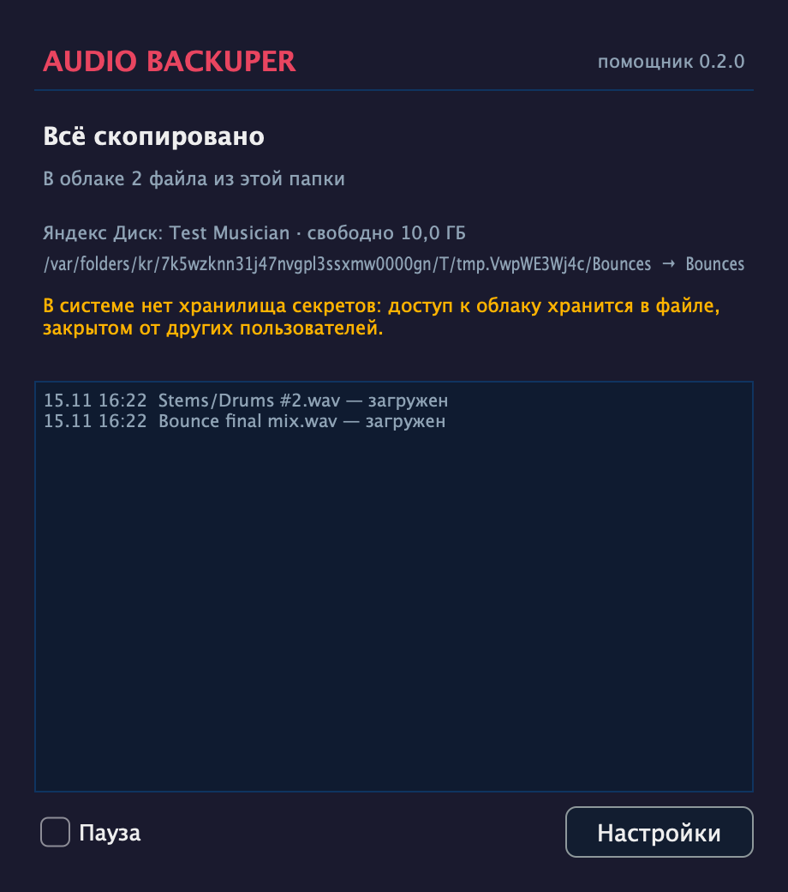

# SoundGit

Платформа контроля версий и совместной работы над проектами цифровых звуковых рабочих станций (DAW).

В репозитории два продукта:

- **SoundGit** — «Git для музыки»: история версий проекта DAW, сравнение и слияние по смыслу, хранение аудио без дублирования.
- **Audio Backuper** — отдельный лёгкий плагин, который копирует новые и изменённые рендеры из папки в облако пользователя.

Идея, архитектура и поэтапный план — в [openspec/vision.md](openspec/vision.md), [openspec/architecture.md](openspec/architecture.md), [openspec/roadmap.md](openspec/roadmap.md).

## Состояние

| Компонент | Статус |
|---|---|
| Ядро `soundgit` (Go): парсер `.rpp`, модель проекта, семантическое сравнение, локальная история | прототип, проверен на проектах из Reaper 7.86 |
| Audio Backuper: помощник (Go) и плагин (JUCE: AU, VST3) | прототип, проверен в Reaper на поддельном облаке; на настоящих облаках, в Logic Pro, Ableton Live и под Windows не проверялся |
| Трёхстороннее слияние | в планах |
| Дедупликация (FastCDC) и объектное хранилище S3 | в планах |
| Сервер метаданных (NestJS, PostgreSQL), аутентификация | в планах |
| Lock-файл и пакетный менеджер плагинов | в планах |

## Структура репозитория

```
soundgit/
├── core/                    Go-модуль: ядро SoundGit и помощник Audio Backuper
│   ├── cmd/soundgit/                 CLI контроля версий — см. core/README.md
│   ├── cmd/audio-backuper-helper/    фоновый помощник плагина
│   └── internal/backuper/            слежение за папкой, очередь, облака, вход, локальный API
├── juce-client/             плагин Audio Backuper (C++17, JUCE 8)
├── testdata/                тестовые проекты Reaper
├── tools/reaper/            скрипты проверки в Reaper
└── openspec/                концепция, архитектура, план, спецификации
```

## SoundGit: ядро

Локальная история версий проекта Reaper: `init`, `commit`, `status`, `log`, `diff`, `restore`. Подробности — в [core/README.md](core/README.md).

```bash
cd core
go build -o soundgit ./cmd/soundgit
go test ./...
```

## Audio Backuper

Плагин ставится на мастер-шину и следит за папкой с рендерами. Каждый новый или изменённый аудиофайл копируется в облако — Яндекс Диск или Google Drive. Звук плагин не трогает.



### Как устроен

```
┌──────────── DAW ────────────┐      ┌──────────── DAW ────────────┐
│ плагин (окно и состояние)   │      │ ещё один экземпляр плагина  │
└──────────────┬──────────────┘      └──────────────┬──────────────┘
               │ HTTP на 127.0.0.1, случайный порт, секрет из файла владельца
┌──────────────▼────────────────────────────────────▼──────────────┐
│ помощник — один на пользователя, лежит внутри плагина            │
│  слежение за папками → очередь на диске → загрузка в облако      │
└──────────────────────────────┬───────────────────────────────────┘
                               ▼
                 Яндекс Диск или Google Drive
```

- **Ничего не нужно ставить отдельно.** Помощник — один исполняемый файл внутри бандла плагина; первый загруженный экземпляр его запускает.
- **Один помощник на всех.** Все экземпляры плагина во всех DAW работают с одним процессом.
- **Догружает после закрытия DAW.** Очередь хранится на диске; помощник завершается сам, когда она пуста и плагинов нет.
- **Новые и изменённые файлы.** Файлы, появившиеся при выключенном помощнике, подхватываются при следующем запуске. Файлы, лежавшие в папке до настройки, сами не загружаются — для них есть кнопка.
- **Структура папок сохраняется.** Прежняя версия изменённого файла по умолчанию остаётся рядом под именем с датой.
- **Доступ только к своей папке в облаке.** Вход — на странице облака в браузере; токены лежат в системном хранилище секретов.
- **Локальный интерфейс закрыт.** Запросы без секрета и запросы от веб-страниц отклоняются; секреты в ответах не передаются.

Поведение описано в спецификациях `openspec/changes/rebuild-audio-backuper/specs/`, решения — в `design.md` там же.

### Сборка

Нужны CMake 3.22+, компилятор C++17 и Go 1.26+. JUCE 8.0.4 скачивается при первой сборке.

```bash
cd juce-client
./build.sh
```

Скрипт собирает помощника (на macOS — универсального, для Intel и Apple Silicon), кладёт его в бандлы, подписывает их и на macOS устанавливает AU и VST3 в папки плагинов текущего пользователя.

### Подключение облаков

Вход через браузер работает только с приложением, зарегистрированным в облаке. Идентификаторы задаются при сборке:

```bash
cp juce-client/oauth.example.json juce-client/oauth.json   # и заполнить
```

| Облако | Где зарегистрировать | Какие права |
|---|---|---|
| Яндекс Диск | oauth.yandex.ru | доступ к папке приложения и информация о диске |
| Google Drive | Google Cloud Console, клиент типа «Desktop app» | `drive.file` |

Файл `oauth.json` в репозиторий не попадает. Без него облака показаны в окне как недоступные в этой сборке; для разработки остаётся ручной ввод токена Яндекса.

### Проверка

```bash
cd core && go test ./...                 # помощник: логика, оба облака на поддельных серверах
tools/reaper/backuper-e2e.sh             # плагин в настоящем Reaper + поддельное облако
tools/reaper/backuper-idle.sh            # нагрузка помощника в простое
tools/reaper/backuper-screens.sh out/    # изображения окна во всех состояниях
auval -v aufx AbkR YrSt                  # проверка Audio Unit, которую делает Logic
```

### Что не проверено

- Настоящие Яндекс Диск и Google Drive: клиенты проверены только на поддельных серверах, воспроизводящих их протокол.
- Logic Pro и Ableton Live: нужна ручная проверка. Проверка Audio Unit (`auval`) проходит, но она не заменяет запуск в Logic.
- Windows: код собирается кросс-компиляцией, плагин под Windows не собирался и не запускался.
- Установщики, подпись разработчика и нотаризация: без них плагин работает только на машине, где собран.

## Происхождение

Магистерская диссертация (МАИ, кафедра 806) «Разработка платформы контроля версий и организации совместной работы над проектами цифровых звуковых рабочих станций».
